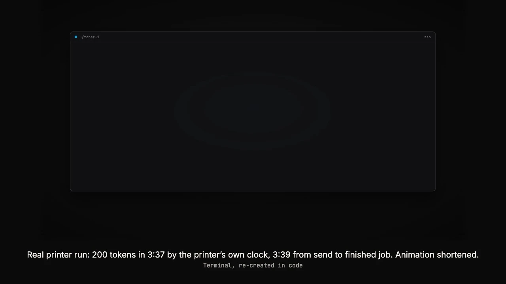

# TONER-1

**We're proudly pushing forward the PostScript Pareto Frontier.**
TONER-1 is state of the art among language models that run entirely inside a print job. That category has very few entrants.

That's the parody. Here is the real part. TONER-1 is a small language model whose weights, forward pass, sampler and page layout are all in one PostScript file. Send that file to a PostScript printer and the printer's own processor writes a short children's story, one token at a time, then typesets it and prints the page. The computer that sends the file does no arithmetic at all (0 FLOPs).

- **TONER-1** is Andrej Karpathy's llama2.c `stories260K` (260,032 parameters), stored as int8 with one scale per row, plus a forward pass written in PostScript ([`engine/engine2.ps`](engine/engine2.ps)). The whole model is one 595,177-byte print job: [`print-jobs/TONER-1_print-job.ps`](print-jobs/TONER-1_print-job.ps).
- **TONER-1-V** adds a 103,536-parameter doodle model trained on Google's Quick, Draw! drawings. Its print job, [`print-jobs/TONER-1-V_print-job.ps`](print-jobs/TONER-1-V_print-job.ps) (859,300 bytes), writes a story and then draws a 16x16 one-bit doodle of the first drawable noun in it. The two models together have 363,568 parameters.
- **TONER-1 Pro** is `stories15M` (15.2M parameters) running on the same engine. It is a 31.6 MB print job, too big for this repo; [Reproduce](#reproduce) shows how to build it.

**Status**

<!-- PRINT_DAY:status -->
Tested in Ghostscript; the first real printer run is pending.
<!-- /PRINT_DAY:status -->

<!-- PRINT_DAY:proof -->
<!-- /PRINT_DAY:proof -->

**Video:** files in [`docs/media/`](docs/media/). The [MP4 version](docs/media/TONER-1_readme_loop.mp4) has the same loop as the image below.

[](docs/media/TONER-1_readme_loop.mp4)

## Quickstart

**Preview with Ghostscript.** No printer is needed. Each run takes a few seconds, and any seed works.

```sh
gs -dSEED=7 -sDEVICE=pdfwrite -o page.pdf print-jobs/TONER-1_print-job.ps
gs -dSEED=7 -sDEVICE=pdfwrite -o page-v.pdf print-jobs/TONER-1-V_print-job.ps   # story + doodle
```

As it generates, the story also streams to the terminal. You can override these settings:

| Setting | Default | What it does |
|---|---|---|
| `-dSEED=` | 42 | Seed for the sampler |
| `-dTEMP=` | 0.8 | Sampling temperature; 0 means always pick the most likely token |
| `-dSTEPS=` | 200 | Maximum number of tokens |
| `-dDTEMP=` | 0.9 | Temperature for the doodle model (TONER-1-V only) |

**Print it.** Only do this on a PostScript printer that you own or have permission to use. Send the file raw, for example:

```sh
nc <printer-ip> 9100 < print-jobs/TONER-1_print-job.ps
lpr -P <queue> -o raw print-jobs/TONER-1_print-job.ps
```

A printer has no command line, so to change the seed you edit the `42` in `/SEED 42 def` inside the file. The job needs a PostScript interpreter, Level 2 or later. A printer that only speaks PCL or GDI may print the file as pages of text instead. A printer is estimated to run at 0.3 to 5 tok/s, so a page takes roughly 1 to 10 minutes. That estimate is unmeasured, and a long job can hit the printer's job timeout or run out of memory. PostScript's `rand` differs between implementations, so a printer will probably tell a different story from the same seed than Ghostscript does.

## How it works

Everything below happens inside the print job. [`docs/TONER-1/01_explainer.pdf`](docs/TONER-1/01_explainer.pdf) walks through it on two pages, quoting the actual code.

- **Weights as PostScript strings.** [`tools/export.py`](tools/export.py) reads a llama2.c checkpoint and writes every matrix as `[ [row scales] [<hex> <hex> ...] ]`. Each row is a hex string of int8 values offset by 128, with one float scale per row. Inside PostScript, `string i get` returns a byte as an integer. The matrix-vector product `mv` accumulates `byte * x` along the row, subtracts `128 * sum(x)` once, and multiplies by the row's scale. The embedding matrix is shared with the output head. The vocabulary is a list of hex strings of raw bytes.
- **The forward pass** is about 100 lines and follows llama2.c's `run.c` step by step: RMSNorm, the Q/K/V projections, RoPE, causal attention over a KV cache, the output projection, a SwiGLU feed-forward block, and residual connections.
- **RoPE uses degrees.** PostScript's `sin` and `cos` take degrees, so every rotary angle is multiplied by 57.29577951.
- **Grouped-query attention.** `stories260K` has 8 query heads that share 4 key/value heads. Query head `h` reads KV head `h idiv 2`.
- **SwiGLU:** `silu(W1 x) * (W3 x)`, then `W2`. `exp` arguments are clamped at -80 to stay within PostScript's real range.
- **Sampling.** The job takes a softmax at temperature `TEMP`, draws one number from `rand` (seeded with `srand SEED`, after discarding 4 draws), and walks the running sum until it passes that number. At `TEMP 0` it is greedy. Generation starts at the BOS token, with no prompt, and stops at the end-of-story token or after `STEPS` tokens.
- **Typesetting.** The same job decodes the token bytes, maps a few UTF-8 punctuation marks to standard glyphs, and sets smart quotes. It then picks the largest Times size that fits the column and word-wraps the story, avoiding one-word last lines. It also draws the token stream, a "how this page was made" band, and a run card with the number of tokens, seconds and tok/s, measured with `usertime`. The footer names the interpreter that ran the job.
- **TONER-1-V** ([`engine/doodle_engine.in.ps`](engine/doodle_engine.in.ps), [`engine/story_page.ps`](engine/story_page.ps)). The doodle model reuses engine2.ps's forward pass byte for byte: [`tools/build.sh`](tools/build.sh) splices it in and checks that it is identical. That code runs inside its own dictionary, so the story model's weights are never touched. A keyword router picks the first word in the story that names one of 18 classes (cat, dog, bird, fish, duck, rabbit, frog, teddy bear, sun, tree, flower, house, car, apple, cake, soccer ball, light bulb and calculator, with plurals and a few synonyms). If no word matches, the class is `seed mod 18`. The model then samples 64 tokens restricted to the patch tokens. Each token is one 2x2 patch of a 16x16 one-bit image. The job draws the image with `imagemask`.
- **Operators.** Both jobs use only PostScript Level 1 operators plus `rectstroke` (Level 2), and declare `%%LanguageLevel: 2`. To check this, `python3 -I tools/names_used.py print-jobs/*.ps` lists every name a job needs from the interpreter.

## Results

All measurements in this table are from Ghostscript 10.07.1 on an Apple M4 Mac. Printer tok/s has not been measured; the Status line above records the printer run.

| | TONER-1 | TONER-1-V | TONER-1 Pro |
|---|---|---|---|
| Model | `stories260K`, 5 layers, dim 64, 8 heads / 4 KV heads | doodle model, 4 layers, dim 48, 6 heads / 3 KV heads, hidden 128 | `stories15M` |
| Parameters | 260,032 | 103,536 (363,568 with the story model) | 15.2M |
| Print job | 595,177 bytes | 859,300 bytes | about 31.6 MB (not in this repo) |
| Speed in Ghostscript | about 55 to 70 tok/s | about 0.3 s per doodle; about 4 s per illustrated page | about 1.5 to 2 tok/s |
| Speed on a printer | estimated 0.3 to 5 tok/s (unmeasured) | estimated 1 to 15 min per page (unmeasured) | estimated overnight (never run on a printer) |

**Does the PostScript doodle model compute the right thing?** Yes, to within floating-point rounding. On three reference sequences, the logits from the PostScript forward pass in Ghostscript match a float64 Python reference within 4.2e-5. The most likely next patch agrees at all 66 of 66 positions on each sequence ([`pixelart/check/teacher_force_results.json`](pixelart/check/teacher_force_results.json)).

**Can you tell what the doodles are?** In a blind test, 36 doodles generated by the print job (2 per class, shuffled, unlabeled) were shown to an AI model that was not told the labels. It named **24 of 36** correctly. Picking at random would get about 2 right. Objects did better than animals: 17 of 20 objects against 7 of 16 animals. It named none of the dogs, rabbits or frogs (0 of 2 each). An AI model did the judging, not people, and there are only 2 doodles per class, so read the per-class numbers loosely. The details are in [`docs/TONER-1-V/06_blind_test_results.pdf`](docs/TONER-1-V/06_blind_test_results.pdf) and [`pixelart/eval_key/`](pixelart/eval_key/).

The stories and doodles in `docs/` are real model output and have not been edited.

## Benchmarks (PARODY)

> **PARODY. These are not real evaluations.** They are jokes in the shape of a model launch, and the numbers come from the model card in [`docs/TONER-1/02_model-card-and-benchmarks.pdf`](docs/TONER-1/02_model-card-and-benchmarks.pdf). Frontier models from major labs were not run and are not named. "N/A" means only that they cannot execute inside a print job.

| Benchmark (parody) | "Measures" | TONER-1 | Frontier models from major labs |
|---|---|---|---|
| TPS (Tokens Per Sheet) | Output tokens per US Letter sheet. Not tokens per second | 200 | N/A |
| HelloPaperJam | Copy-room commonsense (parody of HellaSwag) | 27.9% | N/A |
| PC LOAD LETTER | Share of outputs printed on the paper size the job asked for | 100.0% | N/A |
| Jam Rate | Invented objects per 100 tokens (lower is better) | 1.5 | N/A |
| TonerBench | Dollars of toner per 1M output tokens (lower is better) | $125 | N/A |
| PostScript Pareto Frontier | Share of the model that executes inside the print job | 100% | 0% |

The [PostScript Pareto Frontier chart](docs/TONER-1-V/01_pareto_frontier.pdf) is also parody.

## Limitations

- **Printer speed is an estimate.** Printer tok/s has not been measured, so every printer speed in this repo is an estimate; the Status line above records the printer run.
- **It is a 260K-parameter model.** The stories are short, simple, and often don't make sense. Most of them are about Lily and Tim.
- **There is no prompt.** Every story starts from the beginning-of-sequence token.
- **Results depend on the interpreter.** `rand` is implementation-defined, so the same seed tells different stories on different interpreters. The pages in `docs/` come from Ghostscript 10.07.1.
- **Some characters are dropped.** Non-ASCII characters are left off the page, apart from a few punctuation marks. They still appear in the interpreter's stdout.
- **TONER-1-V is crude.** It draws 16x16 one-bit doodles in 18 classes, and its animals are hard to recognize. The router is a keyword match, not a model.
- **TONER-1 Pro has never run on a printer.** "Overnight" is an estimate.
- **Printer compatibility.** The jobs need a PostScript interpreter, Level 2 or later. Printers that only speak PCL or GDI won't run them, and long jobs can hit a job timeout or memory limit.

## Reproduce

Requirements: `sh`, `curl`, Python 3 (standard library only for the print jobs), and Ghostscript for previews. These commands run from the repo root and write into `build/`, which git ignores.

```sh
sh tools/fetch_checkpoints.sh      # stories260K.bin + tok512.bin from huggingface.co/karpathy/tinyllamas (SHA-256 checked)
mkdir -p build
python3 tools/export.py checkpoints/stories260K.bin checkpoints/tok512.bin build/weights.ps
sh tools/build.sh                  # assembles build/*.ps and compares them with print-jobs/
```

`tools/build.sh` should print `TONER-1_print-job.ps: byte-identical to print-jobs/TONER-1_print-job.ps`, and the same line for `TONER-1-V_print-job.ps`. The TONER-1-V job reads the doodle weights from [`engine/doodle_weights.ps`](engine/doodle_weights.ps), which [`pixelart/src/export.py`](pixelart/src/export.py) exported from [`pixelart/ckpt/d48L4_16k.pt`](pixelart/ckpt/).

**TONER-1 Pro** (downloads about 61 MB and writes a 31.6 MB job):

```sh
sh tools/fetch_checkpoints.sh --pro    # adds stories15M.bin + tokenizer.bin
python3 tools/export.py checkpoints/stories15M.bin checkpoints/tokenizer.bin build/weights15M.ps
sh tools/build.sh                      # also writes build/TONER-1-Pro_print-job.ps and checks its MD5
gs -dSEED=42 -sDEVICE=pdfwrite -o pro.pdf build/TONER-1-Pro_print-job.ps   # about 2 minutes in Ghostscript
```

**Pages.** `sh tools/make_pages.sh` re-renders the PDFs in `docs/` into `build/pages/`, one Ghostscript run each. `sh pixelart/results/build_results.sh` rebuilds the blind-test results page. `sh tools/render_check.sh 7 0.8 seed7` makes a quick PNG preview.

**The TONER-1-V model** (data, training, int8 export and the correctness checks) is documented in [`pixelart/README.md`](pixelart/README.md). The Quick, Draw! data is downloaded by a script, not stored in this repo.

## Repo layout

| Path | What's in it |
|---|---|
| [`print-jobs/`](print-jobs/) | The two print jobs. Each one is the whole model, ready to send to a printer |
| [`engine/`](engine/) | The PostScript sources: `engine2.ps` (TONER-1: forward pass, sampler, page), the TONER-1-V doodle engine template, page programs, and `doodle_weights.ps` |
| [`tools/`](tools/) | `fetch_checkpoints.sh`, `export.py`, `build.sh`, `make_pages.sh`, `render_check.sh`, the engine splice (`mk_engine.sh`), `wrapws.py` and `names_used.py` |
| [`pixelart/`](pixelart/) | The TONER-1-V training pipeline, its checkpoints, the correctness checks, and the blind test with its answer key |
| [`bench/`](bench/) | PostScript speed benchmarks for different matrix-vector idioms |
| [`docs/`](docs/) | Release PDFs, with their PostScript sources in `docs/*/src/`. Video files go in `docs/media/` |

### Documents

| File | Contents |
|---|---|
| [`docs/TONER-1/TONER-1_booklet.pdf`](docs/TONER-1/TONER-1_booklet.pdf) | All 10 TONER-1 pages in one PDF |
| [`docs/TONER-1/01_explainer.pdf`](docs/TONER-1/01_explainer.pdf) | How a print job runs a language model (2 pages) |
| [`docs/TONER-1/02_model-card-and-benchmarks.pdf`](docs/TONER-1/02_model-card-and-benchmarks.pdf) | Model card and parody benchmarks (2 pages) |
| `docs/TONER-1/03`-`07_story_*.pdf` | Story pages printed by the 260K job. The seed and temperature are in each name; `t0` means greedy |
| [`docs/TONER-1/08_story_pro-15M_seed42_t0.8.pdf`](docs/TONER-1/08_story_pro-15M_seed42_t0.8.pdf) | One story from TONER-1 Pro |
| [`docs/TONER-1-V/TONER-1-V_booklet.pdf`](docs/TONER-1-V/TONER-1-V_booklet.pdf) | All 6 TONER-1-V pages in one PDF |
| [`docs/TONER-1-V/01_pareto_frontier.pdf`](docs/TONER-1-V/01_pareto_frontier.pdf) | The PostScript Pareto Frontier (parody chart) |
| [`docs/TONER-1-V/02_sample_sheet.pdf`](docs/TONER-1-V/02_sample_sheet.pdf) | 72 doodles: 18 classes x 4, seeds 1 to 72, not edited |
| `docs/TONER-1-V/03`-`05_story_illustrated_seed*.pdf` | The TONER-1-V job's own output for seeds 7, 14 and 25 |
| [`docs/TONER-1-V/06_blind_test_results.pdf`](docs/TONER-1-V/06_blind_test_results.pdf) | Blind identification test: 24 of 36 |

These PDFs were rendered in Ghostscript before the first printer run, so they describe that run as pending.

The TONER-1 pages call the print job `toner1.ps`, which was its working name. It is the same file as `print-jobs/TONER-1_print-job.ps`.

## Prior art

- **EXO Labs, llama98.c**: the same `stories260K` model, running on a Windows 98 Pentium II at 39.31 tok/s (https://blog.exolabs.net/day-4/).
- **Nicolas Seriot, PSChess**: a chess program written in PostScript that runs on printers.
- **int-llm-postscript** (https://github.com/nmicic/int-llm-postscript, Aug 2026): a 14K-parameter microGPT in PostScript, run under Ghostscript.
- **llama.ttf**: a language model inside a font file.

## Credits and licenses

- Model architecture, inference reference and the `stories260K` / `stories15M` weights: Andrej Karpathy's [llama2.c](https://github.com/karpathy/llama2.c) and [tinyllamas](https://huggingface.co/karpathy/tinyllamas), MIT License.
- Training data of those models: TinyStories by Ronen Eldan and Yuanzhi Li (2023, [arXiv:2305.07759](https://arxiv.org/abs/2305.07759)), CDLA-Sharing-1.0.
- Training data of the TONER-1-V doodle model: Google's [Quick, Draw! dataset](https://github.com/googlecreativelab/quickdraw-dataset), CC BY 4.0. 171,000 of its drawings were used, rasterized to 16x16 one-bit images.
- This repo's own code, including the PostScript engines and the Python tools, is under the MIT License ([`LICENSE`](LICENSE)). The TONER-1-V weights are released under CC BY 4.0, with attribution to Google's Quick, Draw! dataset. Each print job bundles model weights under the terms listed in [`THIRD_PARTY.md`](THIRD_PARTY.md).

Made by Jacob Sussman. TONER-1 is a working print job and a parody of frontier-model launches.

Not affiliated with or endorsed by Adobe, HP, Artifex, Google, or any AI lab.
